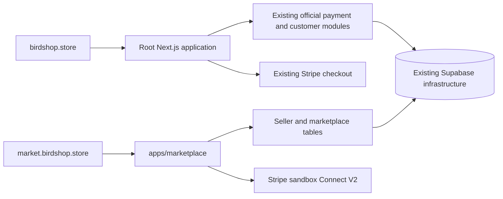

# BirdShop marketplace subdomain — review implementation

The repository now contains two independently built Next.js applications. The official app stays at the repository root, preserving its existing Vercel root and first-party code. The existing marketplace routes and payment integration have moved into `apps/marketplace` as the npm workspace `@birdshop/marketplace`.

This is deployment preparation only. No Vercel project, domain, DNS record, Stripe setting, hosted database, or production branch was changed.

## Architecture

| Concern | Official BirdShop | Marketplace |
| --- | --- | --- |
| Public origin | Existing `https://birdshop.store` / current canonical redirect | Proposed `https://market.birdshop.store` |
| Application root | `.` | `apps/marketplace` |
| Source routes | Root `app/` | `apps/marketplace/app/` |
| Build | `npm run build` | `npm run build:marketplace` from repository root |
| Local port | 3100 in browser tests | 3101 in browser tests |
| Auth cookie | Existing Supabase and staff session cookies | Host-only `birdshop-marketplace-auth` |
| Stripe client | Existing first-party client and configuration | Own process singleton, sandbox keys required |
| Payment webhook secret | Existing `STRIPE_WEBHOOK_SECRET` | `STRIPE_MARKETPLACE_WEBHOOK_SECRET` |
| Account thin webhook secret | None required by official store | `STRIPE_CONNECT_WEBHOOK_SECRET` |
| Saved payment events | Existing `birdshop_stripe_events` | `birdshop_marketplace_webhook_events` and marketplace charge receipts |
| Maintenance | Existing official `/api/maintenance` and schedule | Separate `/api/maintenance`, `MARKETPLACE_CRON_SECRET`; no schedule activated |

Both apps can use the existing Supabase infrastructure after approved migrations. A shared Auth user identity does not share browser sessions: the marketplace uses a different, host-only cookie, never a parent-domain cookie. Owners sign in to the marketplace separately and are checked against the current active owner record on every administrative action. Seller and buyer access is checked with `auth.getUser()` and server-side ownership checks, not user-editable metadata.

The marketplace imports no official checkout, inventory, customer inbox, service-chat, referral or review modules. Its database reads/writes are limited to `birdshop_seller_*`, `birdshop_marketplace_*`, plus owner-role lookup in `admin_users` and the existing shared rate-limit RPC. The service secret stays on the server. Marketplace tables use RLS and service-only grants; customer browsers have no direct financial table access. No seller can use the marketplace app to fetch official customer records.

The small Supabase/config helpers are local to each app so the marketplace cannot accidentally import official customer functionality. Root TypeScript and ESLint exclude `apps/`; the marketplace has its own configuration and package manifest. Shared dependencies install through the root npm lockfile.

## Product flows

- `/`: marketplace discovery with category, search, type, availability and price-order filters. `/marketplace` remains a local compatibility alias for existing links.
- `/shops/[handle]`: existing approved seller storefront, with products/services created in BirdShop.
- `/account`: marketplace buyer email sign-in, order and message entry points.
- `/sell`, `/sell/dashboard`, `/sell/orders`, `/sell/inbox`: existing applications, seller listing editor, moderation requests, financials and fulfillment.
- `/marketplace/messages/*`, `/marketplace/orders`: existing participant-only communication, delivery confirmation and disputes.
- `/admin/resellers/*`: independently authenticated marketplace owner operations. No official admin/customer navigation is included.
- `/sell/connect/*`: authenticated, seller-owned Stripe-hosted verification and Account Link refresh/return flows.

Navigation, shell, typography and responsive styles are independent, using BirdShop's approved logo and charcoal/ivory/burgundy palette. The official store removes unfinished marketplace navigation and reseller administration. Its footer retains one small external marketplace link. Official product/service checkout, digital delivery, chats, referrals, reviews, admin, and Discord integrations remain in the official application.

## Commissions and payments

The existing Connect V2 implementation is reused: Express account configuration, recipient transfer capability, eligible actual account country, durable idempotent creation, secure hosted onboarding, updated/future requirements, verified thin events, server-priced inline Checkout and immutable fee snapshots.

| Tier | Commission | Qualification |
| --- | --- | --- |
| Starter | 8% | Every new seller |
| Bronze | 7% | $500 verified completed USD sales |
| Silver | 6% | $2,500 |
| Gold | 5% | $10,000 |
| Partner | 4% | Current owner approval only |

Unpaid/incomplete, fraudulent, disputed and fully refunded orders do not qualify. Partial refunds reduce qualifying USD volume. Earned tiers are retained; an audited owner override takes precedence for future orders. Rate and fee snapshots on historical orders never change. No currency conversion is needed because marketplace checkout/qualification accept USD only.

The dashboard separately presents actual Stripe USD balances and the internal earnings eligibility journal. Confirmed delivery, buyer confirmation and owner completion precede the proposed seven-day eligibility hold. Only the owner can release journal availability after the hold, with seller/risk/dispute checks. That operation cannot create a Stripe payout or transfer.

**Settlement remains a launch decision.** Sandbox Checkout currently uses destination charges and `application_fee_amount`: these allocate connected funds when the payment succeeds. The internal hold does not delay Stripe payouts or create escrow. Before real payments, select and validate a Stripe-supported payout/settlement approach compatible with a seven-day hold after fulfillment (for example controlled manual payout scheduling, if supported), including the platform/seller countries and maximum holding periods. Do not interpret the internal journal as permission to transfer the destination allocation a second time.

Live Stripe keys are rejected by every client entry point in the independent marketplace app. Checkout is disabled by default and there is no seller payout endpoint. The marketplace stays sandbox-only until a separately reviewed launch change; an environment toggle alone cannot enable live payments.

## Independent Vercel projects — prepared settings

| Setting | Existing official project | New marketplace project |
| --- | --- | --- |
| Git repository | `birdshop-admin/birdshop` | Same repository |
| Root Directory | Keep current `.` | `apps/marketplace` |
| Framework | Next.js | Next.js |
| Install command | Existing `npm ci` | `npm ci --prefix ../..` |
| Build command | Existing `npm run build` | `npm run build` in the selected root |
| Production branch | Keep `main` | Future approved `main`; no deployment now |
| Domain | Leave all existing official domains unchanged | Add `market.birdshop.store` only after approval |
| Ignored Build Step | `node scripts/vercel-ignore.mjs official` | `node ../../scripts/vercel-ignore.mjs marketplace` |

For the marketplace project enable access to files outside the Root Directory if Vercel requests it for workspace installation. The Next.js config sets the tracing/Turbopack workspace root while app imports remain local.

`vercel.json` keeps the marketplace feature branch disabled for the official project. The marketplace's own `vercel.json` sets `git.deploymentEnabled: false` for every branch. The ignored-build script also blocks the marketplace review branch, and requires `main` for future marketplace builds; other official preview branches keep their existing policy. On `main`, a change confined to `apps/marketplace/` skips the official deployment; official-only changes skip a marketplace build. Root manifest/lockfile or deployment-script changes are intentionally shared build inputs and can trigger both builds after approval. GitHub Actions only build/test; no workflow added here deploys either app.

These settings are committed preparation, not claims that the hosted project settings have already been changed. In particular, do not connect/import the new Vercel project with an automatic initial deployment until the owner approves the sandbox deployment procedure.

## Environment separation

Keep the official project's existing environment values unchanged. The marketplace's `.env.example` is its complete server configuration template:

| Marketplace variable | Purpose |
| --- | --- |
| `MARKETPLACE_SITE_URL` | Exact marketplace HTTPS origin. Official BirdShop origins are rejected. |
| `NEXT_PUBLIC_SUPABASE_URL`, `NEXT_PUBLIC_SUPABASE_PUBLISHABLE_KEY` | Shared infrastructure or isolated sandbox project's public connection values |
| `SUPABASE_SECRET_KEY` | Server-only key for the selected backend; never public |
| `STRIPE_SECRET_KEY` | Existing platform's **sandbox/test** secret only |
| `STRIPE_MARKETPLACE_WEBHOOK_SECRET` | Independent signed snapshot-payment destination |
| `STRIPE_CONNECT_WEBHOOK_SECRET` | Independent signed thin Accounts V2 destination |
| `STRIPE_CONNECT_ALLOWED_COUNTRIES` | Explicit eligible seller ISO country allowlist; no US default |
| `BIRDSHOP_MARKETPLACE_CHECKOUT_ENABLED` | `false` until sandbox configuration and migrations are ready |
| `BIRDSHOP_RATE_LIMIT_SECRET` | Marketplace-specific limiter salt |
| `MARKETPLACE_CRON_SECRET` | Marketplace-only maintenance bearer secret |

Do not copy the official live Stripe secret into the marketplace. Do not copy Resend, inventory encryption, order token, official cron, or Discord credentials the marketplace does not use. Secrets must not use `NEXT_PUBLIC_` prefixes.

Supabase Auth's existing official Site URL should stay unchanged. After approval, add the marketplace's exact `https://market.birdshop.store/sell/auth/callback` to the redirect allowlist and send `emailRedirectTo` explicitly. If custom email templates are used, honor the request's RedirectTo rather than sending every link to the official Site URL. Do not use a wildcard parent-domain cookie or broad wildcard production redirect.

## Migration order (not applied to hosted databases)

Review prerequisites and apply to an isolated sandbox first:

1. Existing foundation prerequisites, including `private.birdshop_require_server()` and owner administration.
2. `20261116230000_marketplace_phase1_foundation.sql`.
3. `20261117000000_marketplace_transaction_safety.sql`.
4. `20261117060746_marketplace_connect_tiers.sql`.
5. `20261117064948_marketplace_app_isolation.sql` (separate webhook acknowledgements and ownership-checked eligibility aggregate).

The same root `supabase/migrations` history is retained. No production rows, IDs or table names are moved. RLS, RPC grants, fee snapshots, refunds, tiers, owner approval and the seven-day hold are tested against all four real marketplace migrations in isolated PostgreSQL (PGlite).

## Stripe destinations and sandbox smoke checks

After sandbox approval/configuration:

1. Set the test platform key and verify the platform is eligible for Connect V2, Express recipient accounts and the chosen seller countries.
2. Configure the marketplace snapshot destination at `https://market.birdshop.store/api/stripe/webhook` with its **own** signing secret. Subscribe to Checkout completed/expired/async status, charge refunded/updated/succeeded, refund created/updated/failed, charge dispute lifecycle/funds updates, and early fraud warnings supported by the handler.
3. Configure Accounts V2 **thin** platform (`@self`) events at `/api/stripe/connect/webhook`, including account created/updated/closed, recipient capability/requirements/future requirements/identity/defaults changes. Do not reuse the official webhook secret or assume connected-account snapshot destinations deliver V2 platform account resources.
4. Approve a test seller, choose their actual eligible country, finish hosted verification, and confirm capability/requirements status. Products remain managed in BirdShop; no Stripe product setup is required.
5. Enable sandbox checkout, purchase an approved listing with Stripe test payment methods, and confirm the exact fee, destination, buyer/order binding and stock reservation. Exercise 3DS, failed payment, cancellation, expiry and duplicate delivery.
6. Complete delivery/buyer confirmation/owner review; verify the seven-day journal hold. Exercise partial/full refunds, disputes, fraud warnings and current-state reconciliation. Inspect application fee refunds/transfer reversal choices when issuing refunds.
7. Use the separate authenticated maintenance endpoint to recover missed marketplace events. Activate a scheduler only after deployment approval, using marketplace origin and secret. The existing official scheduler must remain unchanged.

## DNS instructions — do not execute yet

1. Identify the authoritative DNS provider for `birdshop.store`; leave existing apex, `www`, mail and verification records intact.
2. After approval, add `market.birdshop.store` to the **marketplace** Vercel project, not the official one.
3. Copy the exact CNAME target and any ownership TXT challenge shown by Vercel for that project. The target is not known until the domain is attached; do not guess an IP or reuse the official domain's target.
4. Create only the `market` CNAME (TTL 300 seconds is suitable if supported), plus the exact requested verification TXT record. Resolve conflicting records only for that same subdomain. If the provider has HTTP proxying, use DNS-only while validating with Vercel.
5. Verify authoritative resolution, domain ownership and the Vercel certificate. Confirm `https://market.birdshop.store` serves the marketplace, official hosts still serve official BirdShop, cookies stay host-only, callbacks stay on their assigned origins, and webhook signatures validate at the correct app.

## Remaining launch requirements

The implementation is reviewable, but no remote setup or real-account Stripe smoke test was possible without credentials and approval. Remaining work is to approve the PR/architecture, configure an isolated migrated sandbox and its secrets, validate real Connect onboarding/payments/webhooks, select a compatible actual hold/settlement model, review marketplace terms/refunds/disputes and eligible categories, configure Vercel and the domain, and review a separate live-mode change. Real seller payouts remain disabled.

See [test results](test-results.md), [production checklist](production-checklist.md), and the [desktop screenshot](screenshots/desktop.png) / [mobile screenshot](screenshots/mobile.png). Screenshots show local QA fixtures, never fabricated live inventory.
