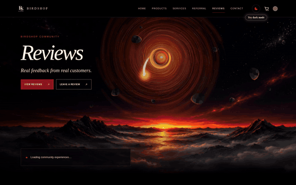

# BirdShop visual repair evidence

This folder contains actual Chromium captures of the website, not UI mockups. Before images use remote branch commit `754d77a6986c94db3cef84114f852cfcb9bc6068`; after images use the repaired production build. The owner's unpushed Codespace commits were not available in this workspace. The remote baseline already rendered its small cart label horizontally here; the repair consolidates its conflicting rules into a native, full-width 50px control.

All captures and browser interactions use a loopback Supabase fixture with clearly named QA catalog records. The normal review captures show the correct empty state. Production still calls `get_approved_reviews`; no sample testimonials, customer totals, or trust claims were added. The signed-in dashboard, review records and email response used by regression tests are test fixtures only. Screenshot capture stubs the unrelated analytics endpoint to avoid local rate-limit noise; it does not validate production analytics.

## Before and after

| Viewport | Product card | Referral page | Reviews |
| --- | --- | --- | --- |
| 390px | [Before](before/product-card-390.png) · [After](after/product-card-390.png) | [Before](before/referrals-390.png) · [After](after/referrals-390.png) | [Before](before/reviews-390.png) · [Final hero](after/reviews-hero-390.png) · [Full page](after/reviews-390.png) |
| 768px | [Before](before/product-card-768.png) · [After](after/product-card-768.png) | [Before](before/referrals-768.png) · [After](after/referrals-768.png) | [Before](before/reviews-768.png) · [Final hero](after/reviews-hero-768.png) · [Full page](after/reviews-768.png) |
| 1440px | [Before](before/product-card-1440.png) · [After](after/product-card-1440.png) | [Before](before/referrals-1440.png) · [After](after/referrals-1440.png) | [Before](before/reviews-1440.png) · [Final hero](after/reviews-hero-1440.png) · [Full page](after/reviews-1440.png) |

Product detail captures: [390px](after/product-detail-390.png), [768px](after/product-detail-768.png), [1440px](after/product-detail-1440.png). Catalog and detail geometry and interactions are also tested at 320px.

## Actual animation recording

[12-second browser recording (MP4)](after/reviews-motion.mp4) · [Animated GIF](after/reviews-motion.gif) · [Independent layer measurements](after/motion.json)



The scene uses a new 1672×941 landscape plate plus separate accretion, lens, rock, cloud, star and dust layers. The old embedded 800×500 image and translucent gradient overlay are no longer rendered. The landscape was generated to preserve the approved reference's mountains, orange horizon, cloud sea and cosmic composition; the moving textures were authored for this scene. No rendering library or browser animation-frame loop was introduced. Visibility and intersection observers pause the scene; reduced motion and JavaScript-free rendering retain a static scene.

## Validation

Final results and exact command output are in [test-results.md](test-results.md) and `logs/`. [Capture checks](after/capture.json) record overflow, image loading and browser errors for all requested screenshots.

The initial suite had 22 passes and one 30-second timeout while saving the existing 320px homepage screenshot after its navigation assertions passed. The final run uses a 90-second budget and freezes animation only for static screenshots. Motion tests and the recorded scene run with animation enabled.

Live Stripe payments, Supabase email delivery, database rules, Discord delivery and payout execution were not exercised. Their application handlers and settings were not changed. No migration, merge, deployment, or change to `birdshop.store` was performed.

## Update an existing Codespace safely

Save or stash uncommitted work first. Fetch, create a backup of the local feature branch, then merge the remote branch so local commits remain in history:

```sh
git fetch origin
git switch feat/aer-charcoal-storefront
git branch backup/birdshop-before-visual-repair
git merge --no-edit origin/feat/aer-charcoal-storefront
npm ci
npm run dev
```

Use a fresh backup name if that branch already exists. Resolve and commit any merge conflicts before starting the preview. Do not use a hard reset or force push to replace divergent local history.
